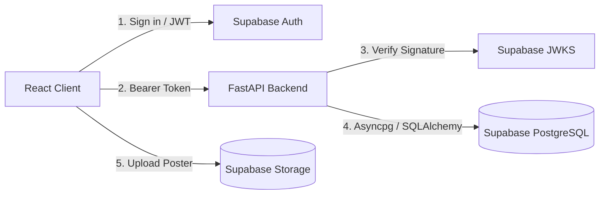

# EventHub: Full-Stack Event Platform & QR Attendance

> **Internship Project Specification — Revised Supabase Edition**  
> Stack: React.js (Vite) + Tailwind CSS | Python (FastAPI) | Supabase (PostgreSQL + Auth + Storage)

---

## 🎯 Architecture Overview

EventHub enforces a strict separation between user identity, business logic, and data persistence:

- **Supabase Auth:** Issues JWTs and handles account lifecycle (`auth.users`).
- **FastAPI:** Main application backend; verifies JWTs via JWKS, enforces concurrency locks, generates opaque QR ticket tokens, and validates one-time check-ins.
- **Supabase PostgreSQL & Storage:** Stores relational data with Row Level Security (RLS) and event poster images.



---

## 🗄️ Database Entity Relationship (ER) Diagram

```mermaid
erDiagram
    profiles ||--o{ events : organises
    profiles ||--o{ registrations : registers
    profiles ||--o{ attendance : checks_in
    categories ||--o{ events : categorises
    events ||--o{ registrations : contains
    registrations ||--o| attendance : has_one

    profiles {
        uuid id PK
        string full_name
        string role
        string avatar_url
        datetime created_at
    }

    categories {
        bigint id PK
        string name
        string slug
    }

    events {
        uuid id PK
        uuid organiser_id FK
        bigint category_id FK
        string title
        text description
        string venue
        datetime start_time
        datetime end_time
        int capacity
        datetime registration_deadline
        decimal fee
        string banner_url
        string status
        datetime created_at
    }

    registrations {
        uuid id PK
        uuid user_id FK
        uuid event_id FK
        string status
        string ticket_token UK
        datetime registered_at
    }

    attendance {
        uuid id PK
        uuid registration_id FK_UK
        uuid checked_in_by FK
        datetime checked_in_at
    }
```

---

## 🚀 Running Locally

### 1. Prerequisites
- **Node.js 18+** (`node -v`)
- **Python 3.9+** (`python3 --version`)

### 2. Backend Setup (FastAPI)
```bash
cd backend
source venv/bin/activate
pip install -r requirements.txt
uvicorn app.main:app --reload --port 8000
```
- API Docs: `http://localhost:8000/docs`
- Healthcheck: `http://localhost:8000/api/v1/health`

### 3. Frontend Setup (React + Vite)
```bash
cd frontend
npm install
npm run dev
```
- Local URL: `http://localhost:5173`

### 4. Running Backend Tests
```bash
cd backend
PYTHONPATH=. ./venv/bin/pytest tests/test_api.py -v
```

---

## 🛡️ Security & Integrity Checklist
- **Atomic Concurrency:** Event rows are locked with `with_for_update()` during registration to prevent overselling past maximum capacity.
- **Opaque QR Tokens:** QR codes contain a cryptographically secure random token (`TK-...`), never exposing database IDs or personal identifiable information (PII).
- **One-Time Check-In:** Tickets can only be scanned and recorded once. Subsequent scans are rejected with an explicit `409 Conflict`.
- **Row Level Security:** Supabase tables have RLS enabled, protecting access through Supabase APIs.

---

## ⏱️ Suggested 6-Minute Live Presentation Walkthrough
1. **0:00–0:45:** Explain fragmented event management problem and EventHub's end-to-end solution.
2. **0:45–1:30:** Browse upcoming events, use filters, and open event details.
3. **1:30–2:30:** Sign in as participant, register for an event, and show generated digital QR pass.
4. **2:30–3:45:** Switch to organiser account, open check-in camera scanner, and scan ticket (or test duplicate scan rejection).
5. **3:45–4:45:** Review real-time analytics (registrations, checked-in count, no-shows, attendance rate) and download participant CSV.
6. **4:45–6:00:** Explain React $\rightarrow$ FastAPI $\rightarrow$ Supabase architecture and JWT verification.
